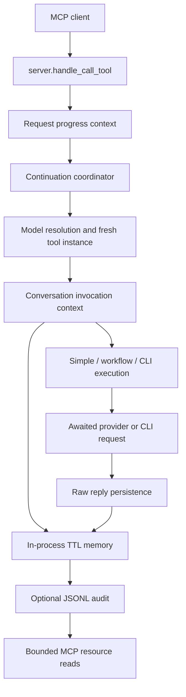

# Server architecture

PAL is a single-user MCP stdio server. A client launches one Python process;
that process owns its conversation memory, provider clients and request tasks.
It exposes tools, prompts and optional transcript resources through MCP 1.x.
Python 3.10–3.12 is the tested matrix; the package requires Python >=3.10.

This describes the implementation after the server reliability work, including
the subsequent prompt and dependency fixes. The [final verification record](feat/wip/server-reliability-and-capabilities/final-verification.md)
separates tested contracts from release gates. It does not establish live model
quality, Windows transcript support or clearance of container findings.

## Request and conversation ownership

`server.TOOLS` holds schema prototypes. Dispatch constructs a new instance for
each call. Model-free tools bypass boundary model selection; consensus resolves
its own participants. `utils/conversation_context.py` owns conversation admission
for simple, workflow and clink execution through a trusted ContextVar that caller
JSON cannot set. Provider-free utilities and Jules actions do not all use this
conversation lifecycle.

For a memory-backed invocation, the owner validates input, creates or loads the
thread, requires two free message slots and saves the raw input before work.
Rendering re-reads the thread so current attachments are available. Success saves
the raw reply once; a local workflow step saves its actual result with null
provider provenance. A failed provider call leaves its real input without a
synthetic assistant turn. Artifact instructions are presentation, not the saved
model response.

`utils/conversation_coordination.py` serializes the same continuation ID from
reconstruction through reply persistence. Different IDs can advance concurrently.
Cancellation releases the lock; its registry retains only holders and waiters.
Direct Python tool calls have admission and state restoration, but callers must
explicitly use the coordinator and separate instances for concurrent same-thread
execution. Reusing one mutable tool concurrently is unsupported.

Workflow metadata stores `work_history` and declared `tool_state` by tool name.
Fresh instances restore their own configuration; older metadata uses defaults.
Planner branches and consensus proposal/roster/responses are included. Consensus
participants receive the original proposal, their own stance and explicit current
attachments. Earlier verdicts and caller summaries stay in the audit history,
outside participant prompts. Counts distinguish complete, partial and failed
consultations. See [conversation semantics](context-revival.md) and
[consensus](tools/consensus.md).

## Providers, policy and budgets

Provider classes declare configuration in `providers/configuration.py`'s
`ProviderConfiguration` format. The registry uses those declarations for setup,
discovery and policy. Shared providers own lazily allocated SDK clients; tool
instances do not own the transports.

Resolution first matches the complete canonical ID or alias in provider priority
order. Only unresolved names can use the supported legacy stance suffixes.
Allowlists then global denies decide eligibility; discovery visibility is a
separate setting. Ordered preferences affect auto/fallback selection and cannot
replace an explicit choice or bypass policy. Malformed configured catalogs are
errors; no credentials is a supported startup state. See
[configuration](configuration.md#model-configuration).

Every backend implements awaited `generate_content`. OpenAI-compatible providers
share request construction/call/parse logic; Azure retains deployment routing,
Gemini uses its async SDK and DIAL owns its shared pool. Retry delays yield and
cancellation propagates. `server.main` joins cleanup before closing its event
loop; unused providers do not allocate clients during cleanup. The transitional
sync invocation adapter has been removed.

`ModelContext` reserves one effective output allowance and sends that same limit
through each endpoint's supported field. Assembled input includes system text,
history, attachments and conservative overhead; oversized requests fail before
provider I/O. File admission and rendering share the remaining allowance and
report actual coverage, including omissions. Missing usage remains unknown.
See [request budgets](configuration.md#provider-request-budgets).

## Files, state and diagnostics

Context reads retain the deny policy in `utils/security_config.py`, including
sensitive home paths and pseudofilesystems. Reads enforce a byte bound before
decoding. Artifact writes have a separate operator-selected `PAL_WORKSPACE_ROOT`
and exclusive, unique files in `.pal_artifacts`; failures are explicit. Clink
uses a filtered vendor environment and configured cwd or a per-call scratch
directory. Neither scratch cwd nor environment filtering is an OS sandbox;
HOME still permits CLI authentication from disk. Existing edit controls remain.

`utils/state_dir.py` and `utils/log_dir.py` resolve PAL overrides, XDG and per-user
fallbacks outside the package. Memory remains process-local TTL storage.
`PAL_TRANSCRIPTS=true` enables private JSONL audit writes after successful memory
writes and bounded `pal://threads` resources. Transcripts never restore expired
or restarted conversations. Separate mutually untrusted clients/projects and
server processes must use separate state directories. POSIX permissions are
enforced; Windows recording fails closed pending native ACL support.

Storage errors before input persistence prevent execution. Expert failures,
including empty or blank responses, use MCP tool errors; direct workflow callers
receive `ToolExecutionError`. Structured file-budget errors retain their diagnostics.
A save failure after
generation returns the answer with a memory warning. Progress notifications use
request-local tokens and heartbeat tasks; failures retain the primary result and
emit diagnostics. Transcript failures warn without rolling back successful
memory writes. [Logging](logging.md) specifies retention, resource bounds and
error codes; [progress](progress.md) specifies notification/result metadata.

## Optional services and measurement

[OpenCode Go](opencode-go.md) is explicitly configured, with hidden initial
candidates and per-request conversation headers. Messages-only models lack an
adapter. [Jules](tools/jules.md) is an independent action tool: explicit source and
branch, plan approval by default, opt-in automatic PR creation, and no blind
creation retry. Neither integration's offline tests establish live readiness.

The [strict simulator](testing.md#simulator-tests) owns one real MCP stdio session
per scenario and a credential-isolated loopback stub. It checks transport/state
contracts, not reasoning quality. [Cache measurements](cache-measurement.md)
capture actual dispatcher/SDK requests and per-call usage without counting
restored aggregates. Stable rendering was adopted; further layout changes were
rejected by [ADR 0001](adr/0001-retain-conversation-history-layout.md). No live cost
or quality benefit is inferred from prefix similarity.

## Evolution and rollback

Keep MCP 1.x, pip-tools locks and the existing release workflow. Roll back async
interfaces with their callers/tests, and JSON/schema changes with their declared
compatibility windows. Planner/tracer legacy model fields remain accepted for
PAL 1.x. Optional services and transcripts can be disabled by configuration;
existing audit files remain on disk. Turning off transcripts does not recover
memory or remove retained data. See [release notes](../CHANGELOG.md) for user-visible
defaults and [tool compatibility](tool-surface.md) for the schema window.
