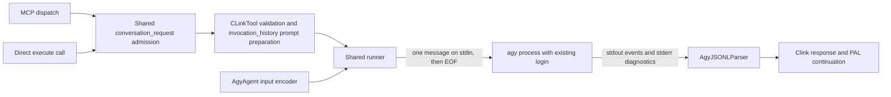

# Antigravity CLI support in clink

> Status: revised contract approved 2026-10-14; Task 1 done; implementation pending
> Created: 2026-10-10
> Source: [PAL issue #465](https://github.com/BeehiveInnovations/pal-mcp-server/issues/465)
> Reference CLI: `agy` 1.3.5
> Upstream follow-up: [agy #1233](https://github.com/google-antigravity/antigravity-cli/issues/1233)
> Plan: [implementation.md](./implementation.md)
> Work tracking: [tasks.md](./tasks.md)
> Evidence: [verification.md](./verification.md)
> Review: [review-design.md](./review-design.md)
> Implementation prerequisite: Task 1 establishes the enterprise capability contract; full authentication acceptance remains a Task 6 release requirement

## Problem and outcome

Users want to invoke their installed Antigravity CLI through PAL's existing `clink` tool, using their existing Google login/subscription without supplying an API key to PAL. The same integration must accommodate an already-configured enterprise CLI. It must preserve clink's roles, conversation continuation, and existing clients, and distinguish inherited agy permissions from PAL's explicit edit-mode request.

Issue #465 described argument-based prompts and plain-text output in v1.0.16. The user selected 1.3.5 as the current reference. Verification established a documented structured-stdin interface, so this design uses a thin protocol adapter and shares the existing subprocess lifecycle. It does not implement the issue's proposed `prompt_to_arg` configuration.

On 2026-10-14 the user approved inheriting agy's saved permissions instead of requiring PAL to force a no-edit policy. For agy, `allow_edits=false` omits PAL's edit-enabling mode flag; it does not downgrade saved permissions or guarantee read-only execution. `allow_edits=true` requests `--mode accept-edits`. This replaces the earlier A4 prerequisite and removes that permission blocker. The [live investigation and reruns](./capability-evidence.md) establish enterprise transport, operator-configured external reads, and native edit opt-in on 1.3.5; other evidence gaps remain explicit.

## Users and acceptance criteria

The target users are individuals with an existing Google CLI login and organization users with enterprise authentication configured in agy. Workspace membership alone is not an asserted entitlement.

| ID | Required outcome | Evidence required |
| --- | --- | --- |
| A1 | Existing login works without a mandatory API key, PAL credential parameter, or provider switch | Live 1.3.5 personal and enterprise runs through PAL's filtered child environment; personal run has no API-key dependency |
| A2 | Default, planner, and codereviewer requests return a completed answer | Role-specific transport tests and live acceptance, including content-dependent project-file reads in both working-directory modes |
| A3 | A follow-up using PAL's continuation ID includes preceding conversation context | MCP and decorated direct-call tests plus clink simulator; a new CLI process serves each request |
| A4 | Agy permissions remain owned by its configuration; false adds no edit-enabling mode flag, true requests `--mode accept-edits`; PAL does not change saved settings | Captured argv for both values, native opt-in evidence, settings-preservation and per-request argument-isolation checks; schema and docs explicitly disclaim a read-only guarantee |
| A5 | Unsupported path restrictions fail before execution | No subprocess starts when agy receives `editable_paths` |
| A6 | Forwarded prompts are absent from command argv, command metadata, and PAL command logs | Subprocess capture and log assertions using distinctive prompt markers |
| A7 | Failures and incomplete runs are explicit; PAL does not automatically replay failed or timed-out invocations | Exit/status/protocol/authentication/timeout tests and one process-start assertion per invocation |
| A8 | Existing clients and default selection remain compatible | Existing clink regression suite and byte-for-byte stdin assertions |

An unavailable account or platform is an unverified acceptance row, not a passing result. Normal credential-free CI can skip explicitly opt-in live tests; the release evidence must still distinguish verified coverage from missing coverage.

## Authentication and upstream support

PAL launches agy as the same configured subprocess user with the existing environment behavior. Authentication remains owned by agy, including its normal use of saved credentials. PAL does not read keyrings, copy tokens, initiate login, rotate accounts, or require `GEMINI_API_KEY`. An absent or expired session must produce a clear execution error directing the user to sign in through agy. Enterprise authentication stays configured outside PAL. [Official authentication documentation](https://antigravity.google/docs/cli/install)

### Child authentication environment

The shared runner filters inherited variables; saved credentials alone do not preserve an environment-selected authentication mode. Declare these names in agy's `CLIInternalDefaults.env_passthrough`, preserving their values only when the operator supplied them:

| Variable | Purpose |
| --- | --- |
| `AGY_ADC_AUTH` | Retain the operator's selection of enterprise Application Default Credentials (ADC) |
| `GOOGLE_APPLICATION_CREDENTIALS` | Retain a configured ADC credential-file location |
| `GOOGLE_CLOUD_QUOTA_PROJECT` | Retain the CLI's environment-based project selection |
| `GOOGLE_CLOUD_LOCATION` | Retain the CLI's environment-based location selection |

These names come from the current [enterprise authentication documentation](https://www.antigravity.google/docs/enterprise) and [ADC search-order documentation](https://docs.cloud.google.com/docs/authentication/application-default-credentials). Task 1 checked their forwarding and an explicit synthetic missing-ADC failure on 1.3.5; this does not verify successful credential/project/location routing. On 2026-10-14 the user approved completing Task 1 with verified enterprise evidence and moving unavailable personal-login, successful ADC routing, and missing/expired cached-session checks to Task 6 as release requirements. Record any additional required names when that coverage becomes available. Do not set `AGY_ADC_AUTH` or select a provider on the user's behalf in production. Keep unrelated secrets excluded and retain the existing precedence: shared and client passthrough names, operator `env_passthrough` additions, then explicit `env` values. Tests use synthetic values; live acceptance uses the same filtered environment as the runner, including a personal case with no ADC selector or API key supplied by PAL.

Google's published FAQ says embedding consumer-plan agy inside third-party agents/applications is unsupported. The user explicitly retained existing-login operation as a requirement after this finding. Document that upstream restriction accurately; do not claim official endorsement, silently substitute API-key-only access, or add an invented technical key requirement. No authentication or quota bypass is part of the feature. [Official FAQ](https://antigravity.google/docs/faq#can-i-use-antigravity-cli-headless-mode-in-third-party-coding-agents-or-automate-account-switching)

## Existing system and proposed boundaries

The following existing mechanisms were rechecked at checkout `2d821f14cb35869added0838827177dc957f6da6` during review. The earlier research record describes `c20d384a`; the agy components and encoding hook below remain proposed additions, not implemented mechanisms.

| Component | Responsibility |
| --- | --- |
| `server.py` | Existing MCP dispatch into the decorated tool execution path |
| `utils/conversation_context.py`, `utils/conversation_memory.py` | Existing shared request admission, turn persistence, history rendering, and storage for both MCP and direct calls |
| `tools/clink.py` | Existing client-specific validation, role/prompt preparation using `invocation_history`, continuation integration, and response limits |
| `clink/registry.py` and `clink/constants.py` | Existing manifest loading, roles, and internal client defaults |
| `clink/agents/base.py` | Existing filtered environment, working-directory lifecycle, process construction, cleanup, timeout, output collection, and parser dispatch; gains one input-encoding hook |
| `clink/agents/agy.py` | New `AgyAgent`: protocol input encoding and the verified agy-specific execution constraints |
| `clink/parsers/agy.py` | New `AgyJSONLParser`: one-request result validation and selected metadata |
| Agent/parser registries and `conf/cli_clients/agy.json` | Mechanical registration, stable protocol flags, and role bindings |

Each request has its own CLI process. There is no process pool, native session reuse, or new persistent store. `agy_conversation_id` is diagnostic metadata; it is not PAL's `continuation_id` and is never used to resume an agy process.

The `conversation_request` wrapper admits and persists input before the body of `CLinkTool.execute()` runs. On continuation, `_prepare_prompt_for_role()` renders the shared invocation's history. Do not add server-side prompt rewriting or bypass the decorator in continuation tests.

## Request and configuration contract

The new client name is `agy`. No fields are added to `CLinkRequest`. Preserve `prompt`, `cli_name`, `role`, `absolute_file_paths`, `images`, `continuation_id`, `allow_edits`, and `editable_paths` and their existing validation. This change makes no new native image-transport promise.

Register the client with runner `agy`, parser `agy_jsonl`, command `agy`, and the existing default, planner, and codereviewer prompt files. Retain the existing default-client selection; adding an alphabetically earlier name must not displace Gemini when configured. Do not pin a new model or change the user's authentication configuration.

The invariant protocol arguments are `--input-format stream-json` and `--output-format stream-json`. They belong in internal defaults rather than being repeated in each role. Command-prefix, role, and additional arguments must not override the transport, inject a print prompt, or enable native continuation. Validate the complete assembled command before launch, covering split and equals forms and the documented aliases; exactly one internal occurrence of each protocol flag is expected. Do not configure output-file capture for this client. Existing clients keep their configuration contracts.

The adapter owns mode selection: reserve `--mode` in command-prefix/config/role arguments and both argument buckets, rejecting split and equals forms before launch. For true, the adapter adds exactly one `--mode accept-edits`; for false, it adds no mode flag. Reject `--dangerously-skip-permissions` in these user-supplied argument locations; neither path needs a blanket bypass. This protects PAL's argument-selection contract; agy's saved mode and permission rules can still permit edits on a false request. See the permission checkpoint below.

Before agy becomes discoverable, `CLinkRequest.allow_edits` and the generated `CLinkTool.get_input_schema()` description must state this agy-specific limitation. Preserve the existing advisory execution-policy prompt for false requests without presenting it as enforcement. `readOnlyHint` remains false. Do not add a warning/confirmation workflow or a new request parameter. Existing clients retain their argument behavior.

For A5, rejection occurs before role-prompt loading, agent creation, and subprocess launch. Shared request admission may already have read a user-supplied `prompt.txt` and persisted the user turn. A5 does not promise rejection before all file reads or conversation writes; this feature retains that shared ordering.

### Working directory and project-file access

Preserve both shared runner modes: an operator-configured `working_dir` selects that directory; when absent, each request receives a fresh temporary cwd. The built-in preset must not hardcode a project directory or infer one from arbitrary prompt text. Clink forwards ordinary project files as absolute references and metadata, so agy must actually read them to perform a review.

Task 1 validates file access and native edit opt-in in both modes using the runner's environment and cwd behavior. In scratch mode, place the disposable project outside cwd and pass its absolute paths. Require a marker available only inside the file and an observable intended opt-in change. A permission denial under the operator's current policy is an observation, not proof of a universal no-edit default. A completed response alone does not establish file access. See agy's [workspace permissions](https://www.antigravity.google/docs/permissions?tab=cli) and [headless soft denials](https://www.antigravity.google/docs/cli/headless/).

The [1.3.5 rerun](./capability-evidence.md#rerun-after-user-enabled-external-access) verified external reads after the user enabled `allowNonWorkspaceAccess`. Document this operator setup when needed; PAL does not enable it automatically. The setting concerns both reads and writes outside the workspace and is not a read-only control. Record actual cwd, reference location, settings scope, and observations for each case. Preserve both cwd modes; a configured-directory run alone is not evidence for the default scratch preset.

## Input and process lifecycle

Add a protected `_encode_stdin(prompt)` hook to `BaseCLIAgent`, called once at the `communicate()` site in `_run_in_directory()`. Its default behavior returns the same UTF-8 bytes currently sent there. `run()` continues to own the working-directory and progress contexts. `AgyAgent` encodes the complete prepared prompt as the content of one `user` event and appends a newline. Use the standard JSON encoder, so quotes, newlines, braces, backslashes, and Unicode remain data. Do not split, shell-quote, or place the prompt into argv.

The shared runner sends that input and closes stdin through its existing communication lifecycle. The documented stream protocol finishes the outstanding turn before exiting after stdin closure. The [Task 1 enterprise probes](./capability-evidence.md#invocation-and-case-matrix) observed this behavior on 1.3.5 in both cwd modes; other authentication/platform coverage remains unverified. No print prompt flag is combined with streaming input. [Official headless protocol](https://antigravity.google/docs/cli/headless#stream-prompts-from-stdin)

Reuse timeout and nonzero-exit handling; do not duplicate `run()` in the adapter or convert a failed agy execution into a successful response through the recovery hook. PAL's configured timeout remains the outer limit. Record any earlier CLI deadline observed in Task 1 rather than assuming the outer timeout changes it. Do not automatically retry failed or timed-out calls. A caller-initiated retry is a new invocation and may repeat effects completed before a failure; this design provides no rollback or cross-request deduplication.

## Response contract

Successful execution requires all of the following:

1. The process exits with code zero.
2. Every nonblank stdout line is a valid JSON event object with a string event name.
3. Exactly one `result` event is present and its payload is an object.
4. Its status is exactly `SUCCESS` and its response is a nonempty string after whitespace checking.

Preserve the response text rather than rebuilding it from progress deltas. Ignore well-formed informational events, including unknown event names, for forward compatibility. Invalid JSON, invalid event envelopes, absent/duplicate results, unknown or unsuccessful statuses, and empty answers raise `ParserError`, which the shared runner exposes as an execution error. A valid-looking result cannot rescue a nonzero process exit. Do not silently fall back to a plain-text parser. These are PAL's proposed acceptance rules, based on the documented result envelope and status field. [Result/status reference](https://antigravity.google/docs/cli/headless#handle-exit-codes-and-errors)

Select metadata explicitly: `agy_status`, `agy_conversation_id`, `agy_duration_seconds`, `num_turns`, and validated numeric token counts under `usage`. Include `model_used` only if the CLI identifies it. Preserve the runner's own `duration_seconds`; external metadata must not overwrite clink's command, client, role, or return code. Missing optional metadata is acceptable; invalid optional values are omitted rather than coercing arbitrary payloads into the result.

## Diagnostics and privacy

For agy, normal responses omit raw event arrays, input events, raw stdout, and complete result envelopes. Keep stderr notices visible with a maximum of 2,048 characters and a truncation indicator when necessary. Scope this bound and the no-raw-stdout error behavior to agy so existing clients retain their response contracts. Error messages include the failure class, return code or result status when known, and bounded diagnostic text.

Permission denials may coexist with a usable final response. Preserve those notices; a successfully returned answer is not proof that every requested operation occurred. Do not infer new success/failure categories by matching arbitrary English stderr text.

The privacy requirement covers the new forwarded prompt in command arguments, command metadata, and PAL command logs. It is not a promise that a model never repeats user text, that child diagnostics cannot contain user data, or that agy's own session storage is disabled. PAL must not add raw stream/prompt debug logging. Existing Claude system-prompt command exposure is a separate recorded follow-up, not silently redefined as fixed by this feature.

## Permission checkpoint

**Accepted contract, 2026-10-14.** This section supersedes the original requirement to prevent writes independently of saved agy settings.

| Request | PAL behavior | Effective permission contract |
| --- | --- | --- |
| `allow_edits=false` or omitted | Add no edit-enabling mode flag; retain the shared advisory no-edit prompt | Agy inherits saved mode and permission rules. Writes, including command-mediated writes, may remain possible. No read-only guarantee. |
| `allow_edits=true` | Add exactly one `--mode accept-edits` | Request native file-edit approval mode. Shell/MCP/other tool rules remain agy's responsibility; this is not a blanket permission bypass or a guarantee every edit succeeds. |
| Nonempty `editable_paths` | Reject through existing preflight validation | No per-path enforcement is claimed. `supports_path_restrictions` remains false. |

The request boolean defaults to false on every request, including continuations. A prior true request must not leave PAL-owned mode arguments in the next invocation; omitting the flag on a later request does not downgrade a permissive saved agy mode. PAL must not rewrite persistent settings, change authentication, or introduce a new sandbox to implement this contract. Operators manage agy's permissions and workspace access. Callers requiring enforced read-only execution must not rely on the agy false flag for that property.

The user reported that 1.3.5 rejects `agy --mode default` and opened [upstream #1233](https://github.com/google-antigravity/antigravity-cli/issues/1233), which was open with no comments when inspected on 2026-10-14. This establishes the reported flag limitation, not proof that every possible restriction mechanism is unavailable. Do not guess that `--mode auto` or `plan` enforces read-only behavior. No downgrade mechanism is required for this version of PAL's agy integration.

Existing [live evidence](./capability-evidence.md) covers default denial under the tested settings and successful native edit opt-in in both cwd modes, with unchanged settings during stable repeats. Those observations do not become broader guarantees under this revision. Remaining authentication/platform gaps, production argument checks, and runtime acceptance still need their planned verification.

### Upstream permission improvement

Track [agy #1233](https://github.com/google-antigravity/antigravity-cli/issues/1233) as deferred enhancement work, not a prerequisite for shipping the inherited-permissions contract. Revisit after an upstream release documents a usable per-invocation downgrade. Before strengthening A4, verify its exact version/flags through the shared runner under permissive saved modes, direct and command/MCP-mediated mutation paths, both cwd modes, conflicting arguments, and concurrent requests. A newly accepted `default` mode flag alone does not prove that shell or other tools cannot write. Then update the adapter, tests, schema descriptions, guide, and contract together. Do not silently change behavior merely because a newer binary accepts a flag.

## Compatibility and evolution

The reference and initial acceptance target is 1.3.5. Older releases are not part of this feature's acceptance matrix; later versions require their own compatibility evidence. No automatic CLI installation, upgrade, downgrade, or undocumented legacy fallback is introduced. Setup documentation asks users to verify the installed version, and incompatible protocol behavior fails explicitly.

The shared encoder defaults to today's behavior, protecting Claude, Codex, and Gemini. Agy-specific parsing and diagnostic limits are opt-in through its registered runner/parser. Existing prompt preparation, response-size limiting, PAL continuation storage, and the MCP request schema remain shared. No runtime Python dependency or dependency-lock change is planned.

## Assumptions

| Assumption | Importance | How to validate |
| --- | --- | --- |
| Existing personal and enterprise sessions are usable from PAL's subprocess context | Required | Verify declared authentication passthrough and live 1.3.5 runs through the filtered environment, with no mandatory API key |
| One input plus EOF returns exactly one complete result | Required | Captured protocol fixture and subprocess test, then live confirmation |
| PAL can omit its mode flag for false and add native edit mode for true without shared argument state or saved-settings mutation | Required; native edit path observed, production adapter pending | Captured argv/continuation/concurrency tests plus stable-settings live opt-in cases |
| Agy can read referenced project files in both cwd modes when the operator permits access | Required; observed in the enterprise environment | Content-dependent reads in configured cwd and outside scratch cwd with recorded operator settings |
| Current role prompts and shared invocation history suffice | Important | Role assertions, two-request tests through MCP and decorated direct execution, simulator |
| Stdlib JSON plus existing async subprocess support suffices | Important | Implementation passes without dependency changes |

## Not Doing

- PAL authentication management or mandatory API keys: agy owns the existing login.
- Legacy v1.0.16 compatibility: the approved reference is 1.3.5.
- Long-lived CLI processes or native session continuation: PAL already owns conversation continuity.
- Generic prompt templates or argument-based prompt transport: one concrete structured-stdin adapter is sufficient.
- Per-path agy editing: enforcement is not established; reject that input explicitly.
- A new OS sandbox or automatic changes to saved user settings: either would require a different architecture decision.
- Enforced read-only execution independent of saved agy policy in this release: the user accepted inherited permissions; a stronger contract is tracked under upstream #1233.
- Broad fixes to unrelated clients, native multimodal support, or a provider/model migration: they are outside this request.

## Rejected Alternatives

| Alternative | Reason rejected |
| --- | --- |
| Mandatory API-key authentication | Conflicts with the user's explicit existing-login requirement |
| Configured `prompt_to_arg` primitive | Current structured stdin avoids argument visibility and length constraints |
| Generic configurable message templates | Expands configuration and validation for one established consumer |
| Standalone agy execution lifecycle | Duplicates shared timeout, capture, and failure handling |
| Plain-text success fallback | Could turn diagnostics or incomplete output into an apparent answer |
| Persistent native agy sessions | Adds state ownership and concurrency work already handled by PAL |
| Blocking this integration until PAL can force a no-edit downgrade | Superseded by the user's explicit inherited-permissions decision; track upstream #1233 and reassess with verified release evidence |

## Verification, rollout, and unresolved work

Follow [implementation.md](./implementation.md) and the ordered [tasks](./tasks.md). Tests must cover transport, semantic failures, logging, inherited/default versus explicit edit arguments, all roles, continuation, and existing-client regressions. Live tests use disposable fixtures and already-authenticated sessions. Record denials or allowed writes against the actual saved policy; do not require universal default denial under revised A4. Missing account coverage stays visible, and configured CLI failures are not converted into skips.

Ship the preset only after the capability and acceptance evidence is complete, documentation describes authentication and upstream support limitations, and the independent design/code/spec checks are satisfied. Rollback consists of removing the agy registration/preset and adapter; the default encoder and existing client behavior remain usable. No data migration is needed.

Task 1 records the observed enterprise invocation contract and the unavailable authentication cases assigned to Task 6 by user approval. Completion of Task 1 permits adapter development, not release acceptance. The former permission blocker is removed by the approved revision; the stronger guarantee is deferred to [upstream #1233](https://github.com/google-antigravity/antigravity-cli/issues/1233). Existing Claude system-prompt exposure remains a separate follow-up in [verification.md](./verification.md#open-decisions-and-follow-up-work). Preserve the shared runner's existing cleanup regression coverage.

The existing documents report an earlier design review, but its linked `review-design.md` is absent from this checkout; see [capability-evidence.md](./capability-evidence.md#repository-validation). This contract revision has user approval and still needs a fresh design review before Task 2; no historical review is claimed to cover it. Task 1 is done and Tasks 2–6 remain pending.
