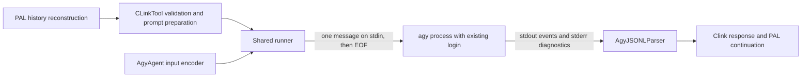

# Antigravity CLI support in clink

> Status: draft; user walkthrough approved; independent design review pending
> Created: 2026-10-10
> Source: [PAL issue #465](https://github.com/BeehiveInnovations/pal-mcp-server/issues/465)
> Reference CLI: `agy` 1.3.3
> Plan: [implementation.md](./implementation.md)
> Work tracking: [tasks.md](./tasks.md)
> Evidence: [verification.md](./verification.md)
> Implementation prerequisite: Task 1 must establish the permission and authentication contract before the client is enabled

## Problem and outcome

Users want to invoke their installed Antigravity CLI through PAL's existing `clink` tool, using their existing Google login/subscription without supplying an API key to PAL. The same integration must accommodate an already-configured enterprise CLI. It must preserve clink's roles, conversation continuation, existing clients, and explicit edit opt-in.

Issue #465 described argument-based prompts and plain-text output in v1.0.16. The user selected 1.3.3 as the current reference. Verification established a documented structured-stdin interface, so this design uses a thin protocol adapter and shares the existing subprocess lifecycle. It does not implement the issue's proposed `prompt_to_arg` configuration.

The design is conditional on a critical capability check: no reliable per-invocation mechanism for enforcing the accepted no-edit default independently of saved agy settings has yet been demonstrated. Task 1 resolves that mechanism and records it here before implementation proceeds. This document deliberately does not invent a permission flag or treat a planning prompt as enforcement.

## Users and acceptance criteria

The target users are individuals with an existing Google CLI login and organization users with enterprise authentication configured in agy. Workspace membership alone is not an asserted entitlement.

| ID | Required outcome | Evidence required |
| --- | --- | --- |
| A1 | Existing login works without a mandatory API key, PAL credential parameter, or provider switch | Live 1.3.3 personal and enterprise runs; personal run has no API-key dependency |
| A2 | Default, planner, and codereviewer requests return a completed answer | Role-specific transport tests and live acceptance |
| A3 | A follow-up using PAL's continuation ID includes preceding conversation context | Server-path test and clink simulator; a new CLI process serves each request |
| A4 | Default requests do not automatically modify user files; explicit edit opt-in works | Task 1 mechanism evidence and live tests, including permissive saved settings |
| A5 | Unsupported path restrictions fail before execution | No subprocess starts when agy receives `editable_paths` |
| A6 | Forwarded prompts are absent from command argv, command metadata, and PAL command logs | Subprocess capture and log assertions using distinctive prompt markers |
| A7 | Failures and incomplete runs are explicit; retries do not duplicate operations | Exit/status/protocol/authentication/timeout tests |
| A8 | Existing clients and default selection remain compatible | Existing clink regression suite and byte-for-byte stdin assertions |

An unavailable account or platform is an unverified acceptance row, not a passing result. Normal credential-free CI can skip explicitly opt-in live tests; the release evidence must still distinguish verified coverage from missing coverage.

## Authentication and upstream support

PAL launches agy as the same configured subprocess user with the existing environment behavior. Authentication remains owned by agy, including its normal use of saved credentials. PAL does not read keyrings, copy tokens, initiate login, rotate accounts, or require `GEMINI_API_KEY`. An absent or expired session must produce a clear execution error directing the user to sign in through agy. Enterprise authentication stays configured outside PAL. [Official authentication documentation](https://antigravity.google/docs/cli/install)

Google's published FAQ says embedding consumer-plan agy inside third-party agents/applications is unsupported. The user explicitly retained existing-login operation as a requirement after this finding. Document that upstream restriction accurately; do not claim official endorsement, silently substitute API-key-only access, or add an invented technical key requirement. No authentication or quota bypass is part of the feature. [Official FAQ](https://antigravity.google/docs/faq#can-i-use-antigravity-cli-headless-mode-in-third-party-coding-agents-or-automate-account-switching)

## Existing system and proposed boundaries

The following existing mechanisms were inspected at checkout `c20d384a9c5a38ab8d58c780d2e269c537e409fa`; the agy components and encoding hook below are proposed additions, not implemented mechanisms.

| Component | Responsibility |
| --- | --- |
| `server.py`, `utils/conversation_memory.py` | Existing PAL conversation reconstruction and storage |
| `tools/clink.py` | Existing request validation, role/prompt preparation, continuation integration, and response limits |
| `clink/registry.py` and `clink/constants.py` | Existing manifest loading, roles, and internal client defaults |
| `clink/agents/base.py` | Existing process construction, environment, timeout, output collection, and parser dispatch; gains one input-encoding hook |
| `clink/agents/agy.py` | New `AgyAgent`: protocol input encoding and the verified agy-specific execution constraints |
| `clink/parsers/agy.py` | New `AgyJSONLParser`: one-request result validation and selected metadata |
| Agent/parser registries and `conf/cli_clients/agy.json` | Mechanical registration, stable protocol flags, and role bindings |

Each request has its own CLI process. There is no process pool, native session reuse, or new persistent store. `agy_conversation_id` is diagnostic metadata; it is not PAL's `continuation_id` and is never used to resume an agy process.

## Request and configuration contract

The new client name is `agy`. No fields are added to `CLinkRequest`. Preserve `prompt`, `cli_name`, `role`, `absolute_file_paths`, `images`, `continuation_id`, `allow_edits`, and `editable_paths` and their existing validation. This change makes no new native image-transport promise.

Register the client with runner `agy`, parser `agy_jsonl`, command `agy`, and the existing default, planner, and codereviewer prompt files. Retain the existing default-client selection; adding an alphabetically earlier name must not displace Gemini when configured. Do not pin a new model or change the user's authentication configuration.

The invariant protocol arguments are `--input-format stream-json` and `--output-format stream-json`. They belong in internal defaults rather than being repeated in each role. Command-prefix, role, and additional arguments must not override the transport, inject a print prompt, or enable native continuation. Validate the complete assembled command before launch, covering split and equals forms and the documented aliases; exactly one internal occurrence of each protocol flag is expected. Do not configure output-file capture for this client. Existing clients keep their configuration contracts.

Permission-related arguments and their validation cannot be finalized from current evidence. Task 1 must specify their effective precedence and reject overrides that would violate `allow_edits=false`; see the permission checkpoint below.

## Input and process lifecycle

Add a protected `_encode_stdin(prompt)` hook to `BaseCLIAgent`. Its default behavior returns the same UTF-8 bytes currently sent to `communicate()`. `AgyAgent` encodes the complete prepared prompt as the content of one `user` event and appends a newline. Use the standard JSON encoder, so quotes, newlines, braces, backslashes, and Unicode remain data. Do not split, shell-quote, or place the prompt into argv.

The shared runner sends that input and closes stdin through its existing communication lifecycle. The documented stream protocol finishes the outstanding turn before exiting after stdin closure. Live 1.3.3 verification remains required. No print prompt flag is combined with streaming input. [Official headless protocol](https://antigravity.google/docs/cli/headless#stream-prompts-from-stdin)

Reuse timeout and nonzero-exit handling; do not duplicate `run()` in the adapter or convert a failed agy execution into a successful response through the recovery hook. PAL's configured timeout remains the outer limit. Record any earlier CLI deadline observed in Task 1 rather than assuming the outer timeout changes it. Do not automatically retry failed or timed-out calls.

## Response contract

Successful execution requires all of the following:

1. The process exits with code zero.
2. Every nonblank stdout line is a valid JSON event object with a string event name.
3. Exactly one `result` event is present and its payload is an object.
4. Its status is exactly `SUCCESS` and its response is a nonempty string after whitespace checking.

Preserve the response text rather than rebuilding it from progress deltas. Ignore well-formed informational events, including unknown event names, for forward compatibility. Invalid JSON, invalid event envelopes, absent/duplicate results, unknown or unsuccessful statuses, and empty answers raise `ParserError`, which the shared runner exposes as an execution error. A valid-looking result cannot rescue a nonzero process exit. Do not silently fall back to a plain-text parser. These are PAL's proposed acceptance rules, based on the documented result envelope and status field. [Result/status reference](https://antigravity.google/docs/cli/headless#handle-exit-codes-and-errors)

Select metadata explicitly: `agy_status`, `agy_conversation_id`, `agy_duration_seconds`, `num_turns`, and validated numeric token counts under `usage`. Include `model_used` only if the CLI identifies it. Preserve the runner's own `duration_seconds`; external metadata must not overwrite clink's command, client, role, or return code. Missing optional metadata is acceptable; invalid optional values are omitted rather than coercing arbitrary payloads into the result.

## Diagnostics and privacy

For agy, normal responses omit raw event arrays, input events, raw stdout, and complete result envelopes. Keep stderr notices visible with a maximum of 2,048 characters and a truncation indicator when necessary. Scope this bound and the no-raw-stdout error behavior to agy so existing clients retain their response contracts. Error messages include the failure class, return code or result status when known, and bounded diagnostic text.

Permission denials may coexist with a usable final response. Preserve those notices; a successfully returned answer is not proof that every requested operation occurred. Do not infer new success/failure categories by matching arbitrary English stderr text.

The privacy requirement covers the new forwarded prompt in command arguments, command metadata, and PAL command logs. It is not a promise that a model never repeats user text, that child diagnostics cannot contain user data, or that agy's own session storage is disabled. PAL must not add raw stream/prompt debug logging. Existing Claude system-prompt command exposure is a separate recorded follow-up, not silently redefined as fixed by this feature.

## Permission checkpoint

**Unresolved:** the precise 1.3.3 mechanism satisfying A4 while preserving the user's saved login and settings.

Before adding an enabled client, Task 1 must document and demonstrate:

- A default invocation cannot automatically modify test files, including through shell or other enabled tools, even when saved settings are permissive.
- An explicitly opted-in invocation can modify an intended disposable file.
- The mechanism does not rewrite the user's persistent configuration, replace authentication, or rely solely on model instructions.
- Configuration/role arguments cannot override the default restriction, and concurrent safe/edit requests cannot contaminate each other's policy.
- Unsupported `editable_paths` is rejected before any subprocess is launched; `supports_path_restrictions` remains false for this version of the feature.

An agy planning mode, a missing bypass flag, an init-event permission label, or a mock alone is insufficient evidence of the first condition. The check concerns requested operations on user/project files, not the CLI's ordinary credential refresh or session bookkeeping.

Task 1 must update this section and the corresponding implementation steps with the verified interface, precedence, failure behavior, and fixtures. If the required mechanism is unavailable, mark the capability task blocked with the concrete evidence and request a design revision. Do not register an enabled client, relax the requirement, or silently make edit-enabled operation the default. If enforcing it needs a new dependency, OS sandbox architecture, or persistent configuration changes, that exceeds this approved approach and must return to design.

## Compatibility and evolution

The reference and initial acceptance target is 1.3.3. Older releases are not part of this feature's acceptance matrix; later versions require their own compatibility evidence. No automatic CLI installation, upgrade, downgrade, or undocumented legacy fallback is introduced. Setup documentation asks users to verify the installed version, and incompatible protocol behavior fails explicitly.

The shared encoder defaults to today's behavior, protecting Claude, Codex, and Gemini. Agy-specific parsing and diagnostic limits are opt-in through its registered runner/parser. Existing prompt preparation, response-size limiting, PAL continuation storage, and the MCP request schema remain shared. No runtime Python dependency or dependency-lock change is planned.

## Assumptions

| Assumption | Importance | How to validate |
| --- | --- | --- |
| Existing personal and enterprise sessions are usable from PAL's subprocess context | Required | Live 1.3.3 runs using each configured login type, with no mandatory API key |
| One input plus EOF returns exactly one complete result | Required | Captured protocol fixture and subprocess test, then live confirmation |
| Effective per-invocation permission control can satisfy A4 within this architecture | Required and unresolved | Task 1 disposable-file and concurrent-policy checks |
| Current role prompts and server-applied history suffice | Important | Role assertions, two-request continuation test, simulator |
| Stdlib JSON plus existing async subprocess support suffices | Important | Implementation passes without dependency changes |

## Not Doing

- PAL authentication management or mandatory API keys: agy owns the existing login.
- Legacy v1.0.16 compatibility: the approved reference is 1.3.3.
- Long-lived CLI processes or native session continuation: PAL already owns conversation continuity.
- Generic prompt templates or argument-based prompt transport: one concrete structured-stdin adapter is sufficient.
- Per-path agy editing: enforcement is not established; reject that input explicitly.
- A new OS sandbox or automatic changes to saved user settings: either would require a different architecture decision.
- Broad fixes to unrelated clients, native multimodal support, or a provider/model migration: they are outside this request.

## Rejected Alternatives

| Alternative | Reason rejected |
| --- | --- |
| Mandatory API-key authentication | Conflicts with the user's explicit existing-login requirement |
| Configured `prompt_to_arg` primitive | Current structured stdin avoids argument visibility and length constraints |
| Generic configurable message templates | Expands configuration and validation for one established consumer |
| Standalone agy execution lifecycle | Duplicates shared timeout, capture, and failure handling |
| Plain-text success fallback | Could turn diagnostics or incomplete output into an apparent answer |
| Persistent native agy sessions | Adds state ownership and concurrency work already handled by PAL |

## Verification, rollout, and unresolved work

Follow [implementation.md](./implementation.md) and the ordered [tasks](./tasks.md). Tests must cover transport, semantic failures, logging, safe/edit behavior, all roles, continuation, and existing-client regressions. Live tests use dedicated disposable fixtures and already-authenticated test sessions. No-account skips are recorded as missing evidence, and real authentication or policy failures must not be converted into skips.

Ship the preset only after the capability and acceptance evidence is complete, documentation describes authentication and upstream support limitations, and the independent design/code/spec checks are satisfied. Rollback consists of removing the agy registration/preset and adapter; the default encoder and existing client behavior remain usable. No data migration is needed.

The unresolved permission interface is tracked in Task 1. Existing Claude system-prompt exposure and general subprocess cancellation/output-file cleanup gaps remain recorded in [verification.md](./verification.md#open-decisions-and-follow-up-work), with concrete follow-up actions. They are not fixed or removed as incidental work here.

The author checked these documents against the inspected code and public evidence. No independent design review or live CLI verification has run. Repository quality checks could not run during drafting because the project virtual environment is absent.
